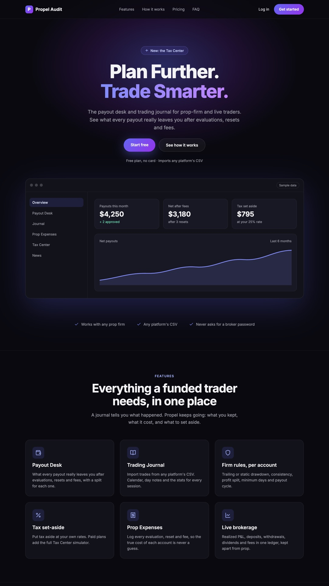
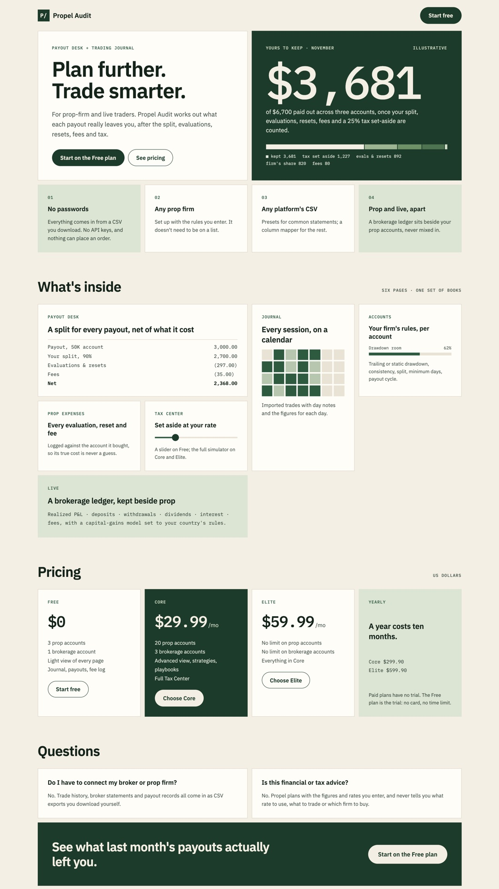
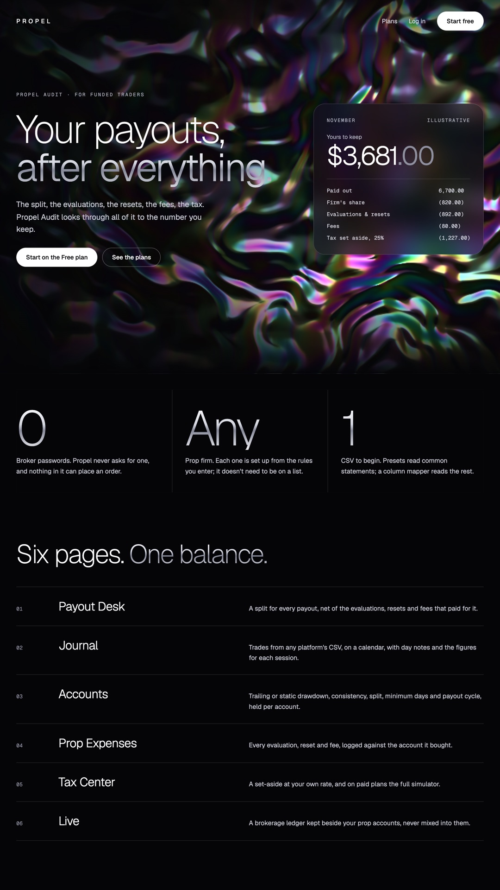
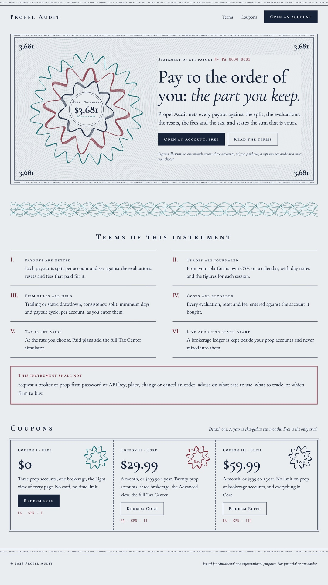
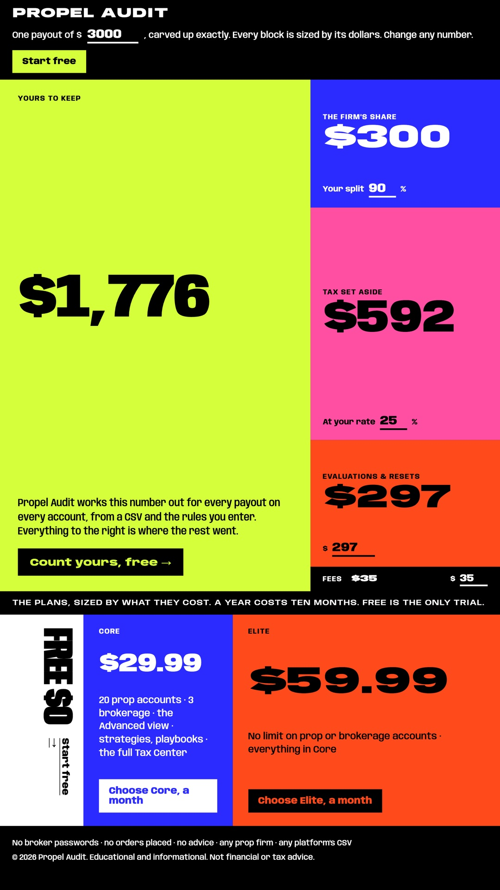
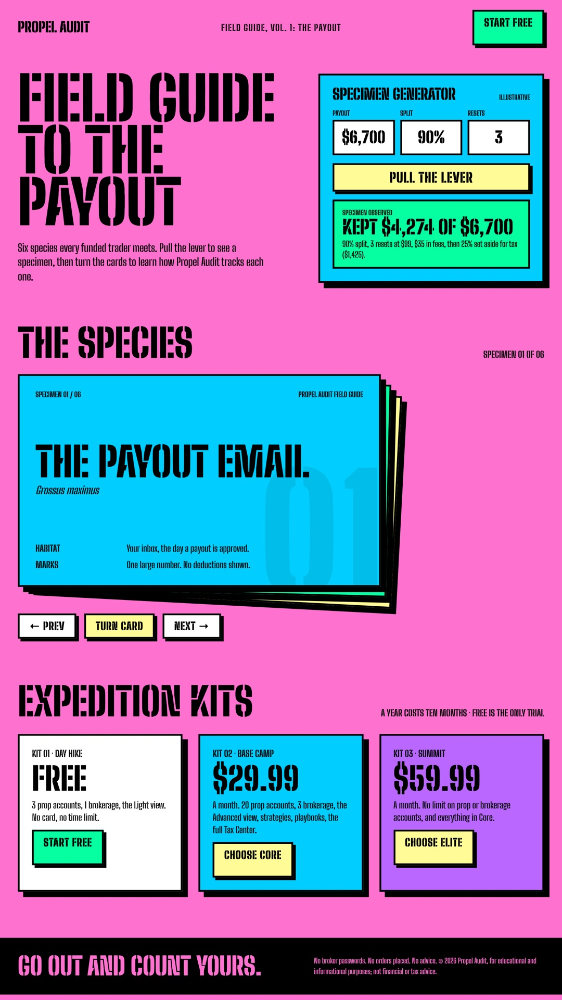

# AntiDesign

A skill for Claude Code (and other agents that read `SKILL.md` skills) that designs web pages the model would never make on its own.

A model's first design is its most probable one: a centred hero, a gradient, three feature cards, three pricing cards with the middle one highlighted. This skill makes the agent write that default down first, trait by trait, then move away from it on purpose with four moves:

1. **Invert** every trait of the default, past the first opposite that comes to mind.
2. **Let the data draw**: the layout is the product's own numbers (blocks sized by value, copy riding a chart line, a hero that is the calculation).
3. **Become a domain artifact**: the page is an object the product's world already trusts, such as a banknote, a bond coupon, a ledger, a boarding pass or a field guide.
4. **Roll** ten traits from a table of ten billion unusual combinations and build exactly what comes out.

Every design ends with a table of the ten traits marked kept or broken; fewer than eight broken means it isn't done, and every design gets a desktop and phone screenshot pass. Four things stay fixed: real facts (sample figures are labelled and add up), accessibility, pages that work on phones, and no copying of real brands.

## Demo

One product, Propel Audit (a payout desk and trading journal for prop-firm traders), designed both ways. Sample figures in the shots are illustrative.

<table>
<tr>
<th width="33%">Without the skill</th>
<th colspan="2">With AntiDesign</th>
</tr>
<tr>
<td rowspan="2" valign="top" width="33%">
<br>
<sub>The default the model makes unprompted</sub><br><br>
<br>
<sub>Rolled from a table of safe options: still generic</sub>
</td>
<td valign="top" width="33%">
<br>
<sub>Fintech: 3D liquid chrome hero</sub>
</td>
<td valign="top" width="33%">
<br>
<sub>Bank: banknote security print</sub>
</td>
</tr>
<tr>
<td valign="top">
<br>
<sub>The layout is the money</sub>
</td>
<td valign="top">
<br>
<sub>Field guide with a slot machine</sub>
</td>
</tr>
</table>

## Elements

Working, self-contained demos in `elements/`, for the agent to re-cut to each product:

| Element | What it is |
|---|---|
| `liquid-3d.html` | A WebGL liquid hero with 180 models: 6 forms × 6 materials × 5 palettes |
| `security-print.html` | Banknote craft: guilloché rosettes and bands generated from sine waves, microtext, lathe-work, coupons |
| `neon.html` | Neon tube type, a number that counts up, a halftone sunset |
| `flow-text.html` | Copy set along a data line that you scroll sideways |
| `quiz.html` | A live-commentary quiz with a scoreboard and glitch type |
| `slot-machine.html` | Reels and a lever that land on an outcome |
| `money-map.html` | One amount split into blocks sized by their dollars, with live inputs |

`references/elements.md` says when to use each one.

## Library

Smaller parts in `library/`: 69 numbered specimens on four pages, each a working mechanism with its own typeface and palette. None of them is a gradient pill, a fade-up on scroll or a centred headline with two buttons.

| Page | Specimens | Examples |
|---|---|---|
| `buttons.html` | 17 | A rubber stamp that inks itself, a ticket stub that tears off, a fuse you hold to burn, a safety cover you lift before you publish |
| `motion.html` | 19 | An odometer, a split-flap headline, words that fall and pile up, a pen plotter, an aperture iris, a thermal receipt fed by scroll |
| `heroes.html` | 13 | A newspaper front page, a crossword, an exploded diagram, a tape measure, a tide chart, a transit line |
| `type.html` | 20 | Letters that melt with the year, a chart inside a sentence, a scannable barcode, words redacted until clicked, text on a spiral |

The agent doesn't pick from them by taste. It rolls for one and re-cuts it to the product:

```bash
python3 scripts/roll.py --library heroes
python3 scripts/roll.py --library buttons --count 3
```

`references/library.md` lists every specimen with when to use it and what to change.

## Install

The skill is plain Markdown plus a standard-library Python script, so it works in any agent that reads `SKILL.md` skills. Leave off `--global` in any `npx skills` command below to install it only in the current project.

### Claude Code

```
/plugin marketplace add fayofye/AntiDesign
/plugin install antidesign@antidesign
```

Or as a personal skill, available in every project:

```bash
git clone https://github.com/fayofye/AntiDesign ~/.claude/skills/antidesign
```

### Codex

```bash
npx skills add fayofye/AntiDesign --global --agent codex
```

Then ask for it by name: `$antidesign`.

### Grok Build

```bash
npx skills add fayofye/AntiDesign --global --agent grok
```

### Cursor, Gemini CLI, GitHub Copilot and other agents

```bash
npx skills add fayofye/AntiDesign --global --agent '*'
```

This installs it for every agent the [Skills CLI](https://github.com/vercel-labs/skills) supports. For an agent it does not know, copy this folder into that agent's skills folder.

### Claude.ai and Claude Desktop

Download this repository as a ZIP (**Code → Download ZIP**) and upload it as a skill in Settings.

### Chat apps without skills (Grok, ChatGPT and others)

Paste `SKILL.md` into the chat or the app's custom instructions. The chat can't run the roll script, so run `python3 scripts/roll.py` yourself and paste the output; the skill tells the agent never to invent a roll. Open the files in `elements/` and `library/` in a browser and attach the ones you want it to adapt.

## Use

Ask for it in your own words, for example "design three unconventional landing pages for this product, nothing templated", or name the skill directly.

To roll designs yourself:

```bash
python3 scripts/roll.py --count 3
python3 scripts/roll.py --trait colour
```

```
Design 1014730075  (drawn: 3319805863 9272279496 9326594069 1014730075 1141958003 1544821760)
  Reading direction: One screen, no scroll; content swaps in place
  Layout: Blocks sized by the product's own numbers
  Hero: A form you fill before you see anything
  Components: Index tabs down one edge
  Type: Comic Neue against Times
  Colour: Thermal camera
  Texture: Halftone dots
  Pricing: Blocks sized by price
  Voice: A horoscope
  Motion: Parallax that tilts in 3D
```

Python 3.8 or later, standard library only. The elements need only a browser.

## License

MIT
